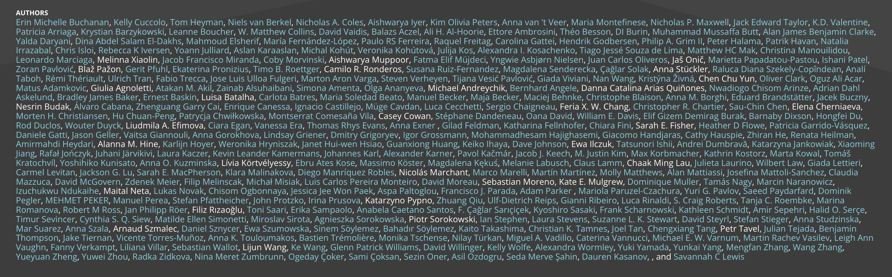
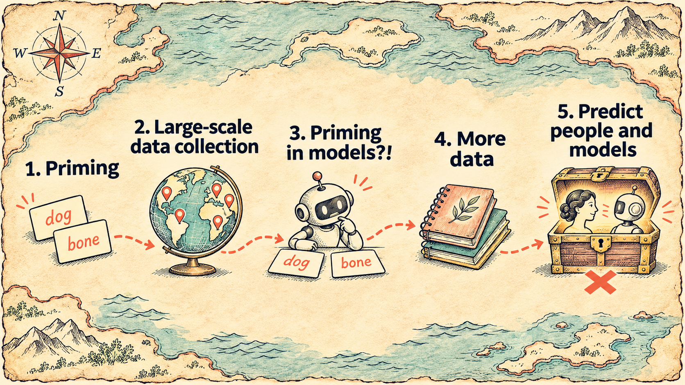
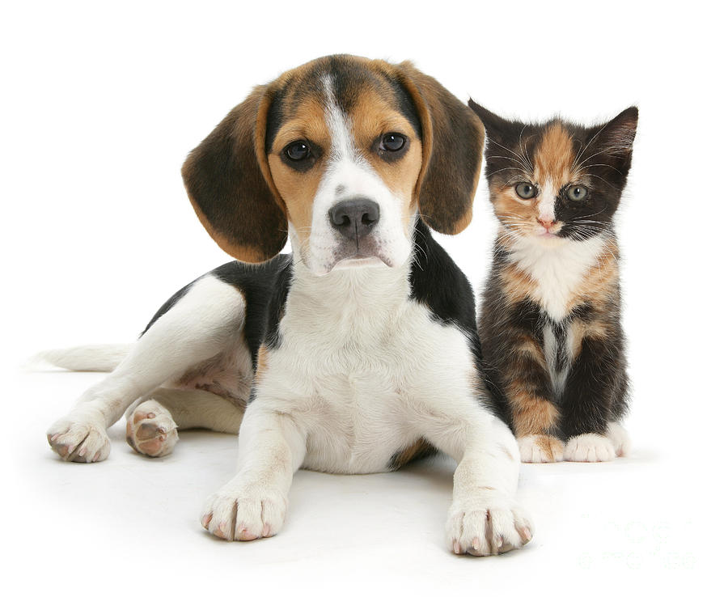
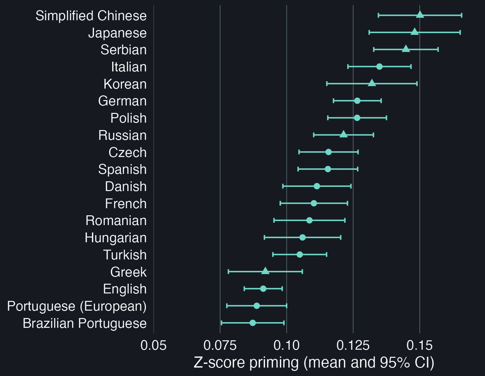
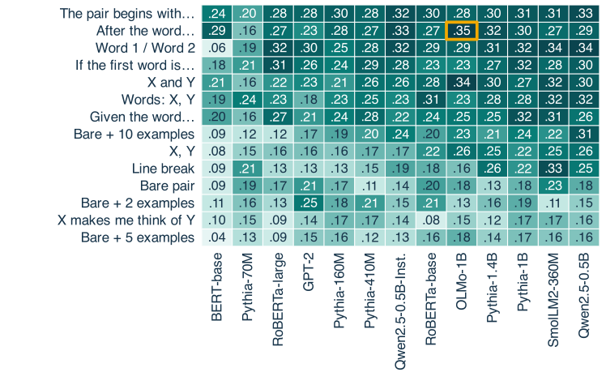
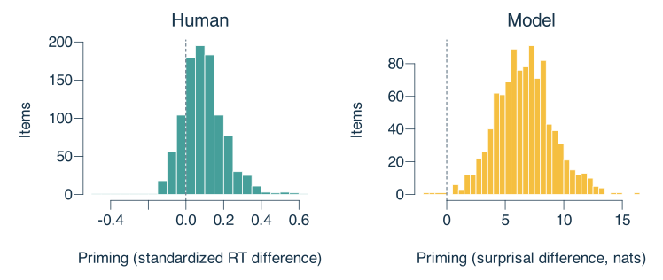
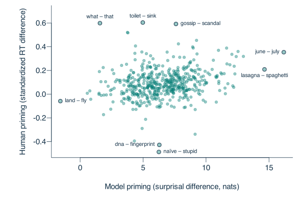
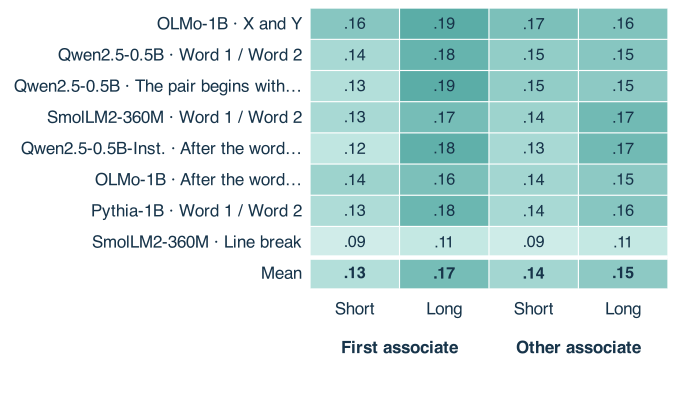

## Many Thanks {.smaller}

```{r}
knitr::opts_chunk$set(echo = FALSE)
library(knitr)
library(ggplot2)
library(dplyr)
library(rio)
library(tidyr)
library(ggridges)
library(nlme)
library(broom)
library(ggrepel)
library(knitr)
library(wordcloud2)
library(flextable)
library(forcats)
```

```{css}
h1.title {
font-size: 1.5em;
}
```

{fig-alt="Semantic Priming Across Many Languages author team" .thanks-authors}

::: {.thanks-logos}
{fig-alt="Psychological Science Accelerator"}

{fig-alt="Leibniz Institute for Psychology"}

{fig-alt="Harrisburg University of Science and Technology"}

{fig-alt="National Science Foundation"}
:::

## Outline {.smaller}



## A related word speeds up recognition{.smaller}

::::: {.columns .pair-demo}
::: {.column width="50%"}
**Related pair**

{width="78%"}

**FASTER**
:::

::: {.column width="50%"}
**Unrelated pair**

{width="78%"}

**SLOWER**
:::
:::::

## A quick history of semantic priming{.smaller}

<ol class="priming-history">
  <li><span class="priming-year">1971</span><strong>Related words are recognized faster</strong><a href="https://doi.org/10.1037/h0031564">Meyer &amp; Schvaneveldt</a></li>
  <li><span class="priming-year">1977</span><strong>Spreading activation and expectancy</strong><a href="https://eric.ed.gov/?id=EJ169109">Neely</a></li>
  <li><span class="priming-year">2013</span><strong>A large English benchmark</strong><a href="https://doi.org/10.3758/s13428-012-0304-z">Hutchison et al.</a></li>
  <li><span class="priming-year">2025</span><strong>19 languages, many participants</strong><a href="https://doi.org/10.1038/s41562-025-02254-x">Buchanan et al.</a></li>
</ol>

<p class="small" style="margin-top: 5rem;">*and, of course, a lot of stuff in between*</p>

::: notes
Early experiments established the effect. Neely varied timing and expectations to probe its mechanisms. The Semantic Priming Project gave us a large English benchmark, and SPAML extended measurement across languages.
:::

## SPAML {.smaller}

::::: {.columns style="align-items: center; gap: 1.25rem;"}
::: {.column width="34%"}
- 19 languages
- 25,163 participants in the analysis
- Every language showed a priming effect
- Priming was similar but did vary across languages
:::

::: {.column style="width: 64%; text-align: center;"}
{height="568px" fig-alt="Forest plot of mean standardized priming and 95% confidence intervals across 19 languages without z-score outlier removal"}
:::
:::::

::: notes
Each row is a language. This plot shows the estimates without z-score outlier removal. The effect is positive across all 19 languages, with some variation in its size. Now that we have human priming estimates, can we get something comparable from a language model?
:::

## SPAML v2 · 19 → 45 languages {#spaml-v2}

::::::: {.columns style="align-items: start; gap: 1.25rem;"}
:::::: {.column width="60%"}
::::: {.columns style="font-size: .80em; line-height: 1.22;"}
::: {.column width="33%"}
[Afrikaans]{style="color: #70d7c9; font-weight: 650;"}  
[Arabic]{style="color: #70d7c9; font-weight: 650;"}  
[Armenian]{style="color: #70d7c9; font-weight: 650;"}  
[Basque]{style="color: #70d7c9; font-weight: 650;"}  
[Bulgarian]{style="color: #70d7c9; font-weight: 650;"}  
[Catalan]{style="color: #70d7c9; font-weight: 650;"}  
[Croatian]{style="color: #70d7c9; font-weight: 650;"}  
Czech  
Danish  
[Dutch]{style="color: #70d7c9; font-weight: 650;"}  
English  
[Estonian]{style="color: #70d7c9; font-weight: 650;"}  
[Farsi]{style="color: #70d7c9; font-weight: 650;"}  
[Finnish]{style="color: #70d7c9; font-weight: 650;"}  
French
:::

::: {.column width="33%"}
[Galician]{style="color: #70d7c9; font-weight: 650;"}  
German  
Greek  
[Hebrew]{style="color: #70d7c9; font-weight: 650;"}  
[Hindi]{style="color: #70d7c9; font-weight: 650;"}  
Hungarian  
[Indonesian]{style="color: #70d7c9; font-weight: 650;"}  
Italian  
Japanese  
Korean  
[Latvian]{style="color: #70d7c9; font-weight: 650;"}  
[Lithuanian]{style="color: #70d7c9; font-weight: 650;"}  
[Norwegian]{style="color: #70d7c9; font-weight: 650;"}  
Polish  
Portuguese
:::

::: {.column width="33%"}
Romanian  
Russian  
Serbian  
Simplified Chinese  
[Slovak]{style="color: #70d7c9; font-weight: 650;"}  
[Slovenian]{style="color: #70d7c9; font-weight: 650;"}  
Spanish  
[Swedish]{style="color: #70d7c9; font-weight: 650;"}  
[Tamil]{style="color: #70d7c9; font-weight: 650;"}  
[Thai]{style="color: #70d7c9; font-weight: 650;"}  
[Traditional Chinese]{style="color: #70d7c9; font-weight: 650;"}  
Turkish  
[Ukrainian]{style="color: #70d7c9; font-weight: 650;"}  
[Urdu]{style="color: #70d7c9; font-weight: 650;"}  
[Vietnamese]{style="color: #70d7c9; font-weight: 650;"}
:::
:::::

::: {.small}
[Teal]{style="color: #70d7c9; font-weight: 650;"} · New priming data 
:::
::::::

::: {.column style="width: 38%; font-size: .82em;"}
### What else can we ask about a word?

- **Age of acquisition** · When did you learn the word?
- **Familiarity** · How familiar is the word?
- **Imageability** · How easily can you picture it?
- **Concreteness** · Does it refer to something tangible?
- **Valence** · How pleasant is it?
- **Arousal** · How calming or exciting is it?
:::
:::::::

::: notes
SPAML analyzed priming in 19 languages. The new grant covers 45 languages overall, with new priming and word ratings collected where there are gaps.
:::

## Can we predict priming? {#predict-item-level-priming}

::::: {.columns}
::: {.column width="48%"}
### In people

- Can we predict the strength of a cue-target pair?
- Item-level priming estimates can be noisy, which makes them hard to predict.

::: {.small}
[Hutchison et al. (2008)](https://doi.org/10.1080/17470210701438111) · [Heyman et al. (2018)](https://doi.org/10.3758/s13428-018-1040-9)
:::
:::

::: {.column width="48%"}
### In language models

- Do LLMs show priming-like effects?
- Do the same targets get the biggest boost in people and models?
- Can we predict these effects?
:::
:::::

::: notes
The grant goal is to predict the size of the human priming effect for individual items. Hutchison and colleagues tested item-level predictors, and Heyman and colleagues showed how unreliable individual estimates can be. The new ratings give us candidate predictors. The next step is to see how a related cue changes a model’s prediction for each target.
:::

## Surprisal: how unexpected is a word? {#surprisal}

<div class="stimulus">I wanted to become a <strong>___</strong></div>

<div class="surprisal-rows">
<div class="srow"><span class="sword">doctor</span><span class="sbar"><i style="width:50%"></i></span><span class="sprob">50%</span></div>
<div class="srow"><span class="sword">teacher</span><span class="sbar"><i style="width:25%"></i></span><span class="sprob">25%</span></div>
<div class="srow hl"><span class="sword">pilot</span><span class="sbar"><i style="width:12.5%"></i></span><span class="sprob">12.5%</span></div>
<div class="srow"><span class="sword">table</span><span class="sbar"><i style="width:.1%;min-width:3px"></i></span><span class="sprob">0.1%</span></div>
</div>

::: {.callout-line}
The less probable the word, the higher its surprisal.
:::

::: {.small}
Used to predict [reading times (Smith & Levy, 2013)](https://doi.org/10.1016/j.cognition.2013.02.013) and [the N400 (Michaelov et al., 2024)](https://doi.org/10.1162/nol_a_00105).
:::

::: notes
These probabilities are illustrative. The same word can have different surprisal in different contexts. Surprisal is the negative log of that probability, so lower probability means higher surprisal. Here we use the change in surprisal to ask whether a related cue makes the target more expected.
:::

## Surprisal as Priming {#a-related-cue-can-change-what-bert-expects}

<div class="cards">
<div class="card"><div class="ctag">Unrelated cue</div><p class="stimulus"><strong>table</strong>. I wanted to become a <span class="mask">[MASK]</span></p><p class="cres">Chance of PILOT: <strong>0.75%</strong></p></div>
<div class="card good"><div class="ctag">Related cue</div><p class="stimulus"><strong>airplane</strong>. I wanted to become a <span class="mask">[MASK]</span></p><p class="cres">Chance of PILOT: <strong>0.86%</strong></p></div>
</div>

::: {.callout-line}
Is PILOT less surprising after AIRPLANE than after TABLE?
:::

::: {.small}
- BERT-base on the [Misra et al. (2020)](https://doi.org/10.18653/v1/2020.findings-emnlp.415) example.
- Two times more probable for related words with minimal context.
- 1.2 times more probable for related words in more context.
:::

::: notes
Misra and colleagues started with related cue, unrelated cue, and target triples from the original Semantic Priming Project. They placed the same target sentence after each cue and masked the target. They read out the probability BERT assigned to the intended target, whether or not it was BERT’s top guess. They also tried presenting each cue in a neutral sentence of its own.

The PILOT probabilities are our own computation, not values reported in the paper: bert-base-uncased gives 6.87 bits after airplane and 7.06 after table (facilitation 0.19 bits; P = .0086 vs .0075). bert-large-uncased gives 5.63 vs 6.25 (0.62 bits). Script: scripts/misra_pilot_example.py. PILOT is about 15% more likely after the related cue. The paper reports only aggregates, in its Figure 1. Reading the plot by eye for single-word cues, BERT-base shows about 1 bit of facilitation (2× the probability) for weakly constraining sentences, falling to about 0.3 bits (1.2×) for strongly constraining ones.
:::


## Calculating Priming {#the-same-contrast-for-people-and-models}

<div class="cards">
<div class="card"><div class="ctag">In people</div><p class="stimulus">RT(<strong>cat</strong> after bus) − RT(<strong>cat</strong> after dog)</p><p class="cres">Positive = faster after DOG</p></div>
<div class="card"><div class="ctag">In models</div><p class="stimulus">Surprisal(<strong>cat</strong> after bus) − Surprisal(<strong>cat</strong> after dog)</p><p class="cres">Positive = more expected after DOG</p></div>
</div>

::: {.callout-line}
Can we use the human data to show the "most aligned" priming scores?
:::

::: notes
These words are illustrative. Human priming uses standardized response times. The contrast carries over directly from Misra’s experiment. A positive score means a related cue made the target faster to recognize in people or more predictable in the model. We used Spearman correlation across targets because the two measures have different units. Autoregressive models score the target as a continuation. Masked models use pseudo-log-likelihood.
:::

## Prompt Sensitivity {#what-should-the-model-see}

<div class="cards">
<div class="card"><div class="ctag">Bare pair</div><p class="stimulus">dog <strong>cat</strong></p><p class="cres">What people saw</p></div>
<div class="card"><div class="ctag">Explicit frame</div><p class="stimulus">After the word dog, comes the word <strong>cat</strong></p><p class="cres">Tells the model where the target goes</p></div>
</div>

::: {.callout-line}
Different prompts and context will give different results, which is best? 
:::

::: {.small}
13 models × 14 prompt setups · 182 combinations

- **Models:** GPT-2, Pythia (70M–1.4B), OLMo, Qwen, SmolLM2, BERT, RoBERTa
- **Punctuation:** dog, cat · dog and cat · Words: dog, cat
- **Frames:** Given the word dog, the next word is cat · dog makes me think of cat
- **With examples:** 2, 5, or 10 related pairs shown first
:::

::: notes
Swap BUS for DOG and score CAT again in the same format. This is a comparison of target probabilities. The grid also included punctuation, other frames, and bare pairs preceded by 2, 5, or 10 examples. The examples came from the discovery half and excluded the item being scored.
:::

## Split-Half Validation {#choosing-a-setup-and-checking-it-on-new-items}

::::: {.columns style="gap: 3rem;"}
::: {.column width="48%"}
### Discovery set

::: {.stat}
500
:::

Model and prompt selected by the highest Spearman correlation with human item-level priming.
:::

::: {.column width="48%"}
### Confirmation set

::: {.stat}
500
:::

Selected model and prompt held fixed and evaluated on new cue-target combinations.
:::
:::::

::: {.small}
English priming data from SPAML ([Buchanan et al., 2025](https://doi.org/10.1038/s41562-025-02254-x)).
:::

::: notes
We split English targets before comparing configurations and stratified by word frequency. The discovery result is the best of 182 combinations. The confirmation result asks how well that choice carries to items that did not choose it.
:::

## Discovery results {#a-frame-helped-the-model-track-human-priming}

{width="92%" fig-alt="Heat map of discovery-half Spearman correlations for 13 models by 14 prompt setups. Frame prompts such as The pair begins with and After the word score highest, about .20 to .35, and bare pairs score lower, about .09 to .23. The top cell, OLMo-1B with After the word, is boxed."}

::: notes
This is the discovery half only: the 500 items used to choose a setup, with every model in every format. The boxed cell, OLMo-1B with the After the word frame (rho = .35), is the highest of the 182 and is the setup carried forward to the confirmation half. Averaged over the 13 models, the bare pair gives .17, bare pairs with 2, 5, or 10 examples give about .17, and the After the word frame gives .28. The top few setups are within about .01 of each other, so the exact winner is partly luck. What mattered here was giving the pair a little structure. The explicit frame tells the model where the target belongs and supplies no target-specific semantic clues.
:::


## Human and Model Priming Distributions {#distributions}

{width="90%" fig-alt="Two side-by-side histograms of priming across 1,000 English items. Human priming, in standardized reaction-time units, is centered slightly above zero. Model priming, in surprisal nats, is centered around 7 and almost entirely positive."}

::: {.small}
OLMo-1B with the After the word frame · all 1,000 English items · raw units, dashed line at zero
:::

::: notes
The two measures are in different units, so the scales are not comparable, only the shapes and where each sits relative to zero. Human priming is positive for 81.5% of items and the model score for 99.6%, so the model finds nearly every target more predictable after a related cue, while some human items show no priming. Both are roughly bell-shaped with a slight right tail. Human priming has heavier tails (excess kurtosis 2.6 against 0.4 for the model). After z-scoring the shapes are not detectably different (Kolmogorov-Smirnov D = .047, p = .22), but z-scoring forces the mean and SD to match, so that is a weak test. What matters is the item-level agreement: Spearman rho = .30 across all 1,000 items, and the sign agrees on 81% of items. Human item-level reliability from the standard errors is .72, so the maximum attainable correlation is about .85.
:::

## Item-Level Correlation {#the-selected-setup-tracked-human-priming-modestly}

{width="65%" fig-alt="Model and human priming across 500 held-out English targets, with a modest positive association."}

::: notes
Every dot is a held-out target. Labeled points are cue–target pairs with the largest misses. Human priming was strongest for what–that, toilet–sink and gossip–scandal, where the model gave little to moderate boosts, and was negative for dna–fingerprint and naïve–stupid, where the model predicted a boost of about 6 nats. The model gave land–fly a negative score (the target got less predictable after the related cue) with essentially no human priming. The model gave its largest boosts to the month and category pairs june–july and lasagna–spaghetti, although human priming for them was moderate (.35 and .21, against a typical .1). The best setup in discovery was OLMo-1B with the explicit frame. The English association shrank on new targets. The grant’s criterion for human-like agreement was a lower 95% confidence bound above .30. The observed lower bound was .15.
:::

## Semantic Priming Project Validation {#the-original-semantic-priming-project}

{width="78%" fig-alt="Heat map of Spearman correlations for eight setups selected in discovery on the original Semantic Priming Project, by cue type and delay. All are between about .09 and .19, with means of .13 and .17 for first associates at short and long delays and .14 and .15 for other associates."}

::: {.callout-line}
The correlations were modest at both SOAs and association types.
:::

::: {.small}
Human data from [Hutchison et al. (2013)](https://doi.org/10.3758/s13428-012-0304-z).
:::

::: notes
We used the eight setups selected in discovery without reselecting them on these data. Some targets overlap with SPAML. On nonoverlapping targets the short/long means were .12/.18 for first associates and .16/.17 for other associates. Neither comparison shows a consistent short-delay advantage.
:::

## What do we take to the other languages? {#the-multilingual-prediction-test}

::::: {.columns}
::: {.column width="48%"}
### Predict people

Use the word ratings and similarity measures to predict which pairs will show stronger human priming.
:::

::: {.column width="48%"}
### Test the models

Score the same pairs and ask how closely the model’s boost tracks the human speedup **within each language**.
:::
:::::

::: {.callout-line}
English gave us a way to measure the match. The multilingual study tells us how far it travels.
:::

::: notes
Return to the treasure map’s final stop. English gave us a scoring procedure and a prompt worth testing. Model choice, prompt wording, and accuracy are open questions within each language. The grant’s broader aims include predicting item-level human priming from word properties and understanding item-level priming in the models.
:::

## References {.scrollable}

::: {#refs}
:::
