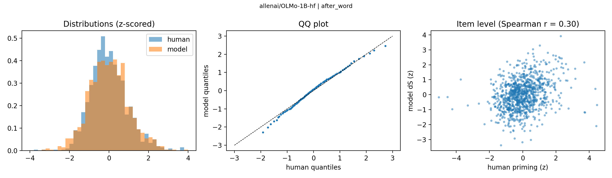
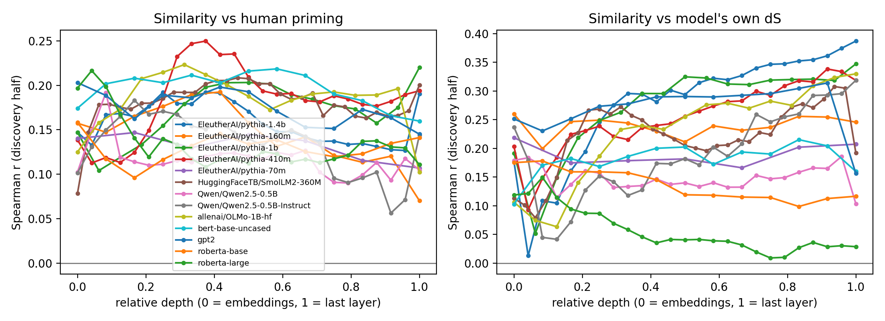

## The question {#sec-question}

<!--
STATUS NOTES (delete before presenting)
- 15-minute talk: 14 content slides, about 1 minute each (timing in the speaker notes; press S to view them).
- Numbers come from the full grid (182 configurations, 13 models) and the SPP validation: outputs/winner_summary.csv,
  confirmation_by_format.csv, spp_validation.csv. Re-run scripts/analyze.py to refresh them and the figures.
- Group means on the format, scale and training-data slides were computed from outputs/confirmation_by_format.csv.
-->

::: {.big}
If a language model finds a word **easier to predict** after a related word,
does it find the **same items** easy that people do?
:::

- People respond faster to CAT after DOG than after BUS: **semantic priming**
- Priming has a fast **automatic** and a slower **strategic** part [@neely1977semantic]
- Our human data use a **single, long SOA**, so they likely mix both

::: {.notes}
~1 min. Frame the item-level question. Flag the long-SOA limitation now so it is not a surprise later.
:::

## Two problems in earlier work

::: {.columns}
::: {.column width="50%"}
### Similarity is not priming

- Cosine similarity between word vectors is static
- Humans show priming and relatedness as separable [@hutchison2003semantic; @lucas2000semantic]
- Here: similarity is a **covariate**, not the outcome
:::
::: {.column width="50%"}
### Context may matter

- Carrier sentences add many words to condition on
- Added context reduced BERT's priming sensitivity [@misra2020exploring]
- Here: we **test** how much context to use
:::
:::

::: {.notes}
~1 min.
:::

## Data

::: {.columns}
::: {.column width="50%"}
### ManyLanguages priming [@buchanan2025semantic]

- 1,000 English targets, each with a related and an unrelated cue
- Outcome: `avgZ_prime` = unrelated minus related z-scored RT
- Single, long SOA
:::
::: {.column width="50%"}
### External check: original SPP [@hutchison2013semantic]

- 1,661 targets, first- and other-associate primes
- Priming at **short and long SOA**
- Used only after configurations are fixed
:::
:::

::: {.notes}
~1 min.
:::

## Model priming

$$\Delta S = S(\text{target} \mid \text{unrelated cue}) - S(\text{target} \mid \text{related cue}), \quad S = -\log P$$

- Positive $\Delta S$: the target is **less surprising after the related cue**
- Causal models (GPT-2, Pythia, ...): next-word probability of the target
- Masked models (RoBERTa, ...): pseudo-log-likelihood [@salazar2020masked; @kauf2023better]
- We read probabilities; decoding settings do not matter

::: {.notes}
~1 min. Same contrast as the human RT difference, computed on the same items.
:::

## Design and what we varied {.smaller}

1. Split items into **discovery** and **confirmation** halves
2. Search all 182 configurations on **discovery only**; winner picked by a rule fixed in advance
3. Score the winner **once** on confirmation; run chosen configs on original SPP, **no re-selection**

- **13 models:** GPT-2, Pythia (70m to 1.4b), OLMo, Qwen2.5 (base, Instruct), SmolLM2, BERT, RoBERTa
- **Prompt formats:** bare, minimal and relation frames, four carrier sentences; plus few-shot (2, 5, 10 pairs)
- **Similarity covariate:** every layer, layer chosen on discovery

::: {.notes}
~1.5 min. Emphasize why the split exists: the grid is large and picking the best on all data would inflate the result.
:::

## Result 1: the distributions look alike

{fig-align="center" width="85%"}

- After z-scoring, human and model priming have the same shape (KS $D$ = 0.05, $p$ = .22)
- The raw scales differ: model priming is positive for 99.6% of items, human for 82%
- Winning configuration shown: OLMo-1B, "After the word X, comes the word Y"

::: {.notes}
~1 min. Do not cite the sign-agreement figure: with these base rates, chance agreement is already about 80%.
:::

## Result 2: the item-level match is modest

::: {.columns}
::: {.column width="50%"}
| | Spearman $r$ [95% CI] |
|---|---|
| Discovery | .35 [.27, .43] |
| Confirmation | .24 [.15, .33] |
| Noise ceiling | about .85 |
:::
::: {.column width="50%"}
- Winner: OLMo-1B with "After the word X, comes the word Y"
- It shrinks on held-out items, as selection predicts
- $\Delta S$ adds 2.6% explained variance beyond similarity and lexical covariates (confirmation)
- Human item reliability is .72, so noisy people do not explain the gap
:::
:::

::: {.notes}
~1.5 min. The central result. Say plainly: the distributions agree, the items only partly.
:::

## Result 3: prompt format matters, not as expected

| Format | Mean confirmation $r$ |
|---|---|
| Bare "cue target" | .07 |
| Bare + 2, 5 or 10 example pairs | .06 |
| Frames that signal a pair (7 formats) | .20 |

- Best frames: "After the word...", "Word 1 / Word 2", "The pair begins with...", "Given the word..."
- Our expectation, that minimal context works best, was **not supported**
- Few-shot examples with the bare frame did **not** help

::: {.notes}
~1.5 min. Means are across the 13 models. Possible reasons (untested): the frame tells the model the two words are a pair, or the earlier BERT result does not carry over to these models. Few-shot was only tried with the bare frame.
:::

## Result 4: scale and training data

Mean confirmation $r$ across frames:

- **Scale (Pythia):** 70m .13, 160m .15, 410m .21, 1b .24, 1.4b .22
- **Training data:** OLMo-1B .21, Qwen2.5-0.5B .22, SmolLM2-360M .24, Pythia-1b .24: about the same
- **Instruction tuning:** Qwen base .22, Instruct .20
- **Architecture:** GPT-2 .17, BERT-base .15, RoBERTa-base .20, RoBERTa-large .23

::: {.notes}
~1.5 min. Alignment rises with scale up to roughly 400m to 1b, then levels off. Training data and instruction tuning change little. Descriptive: models differ in several ways at once, so this is not a causal comparison.
:::

## Result 5: which layer?

{fig-align="center" width="85%"}

- No layer is reliably best: the one chosen on discovery often does worse on confirmation than the last layer (e.g. GPT-2: .08 vs .20)
- Taking the last layer is not systematically worse
- For most models, $\Delta S$ tracks similarity more than human priming does (not BERT-base or RoBERTa-large)

::: {.notes}
~1 min. Counter the habit of always taking the last layer: we report the whole profile.
:::

## What did not help much

- **Few-shot** related pairs (2, 5, 10) did not beat the bare frame (mean $r$ .06 vs .07); with a working frame it is untested
- **Fitted readout**: a cross-validated ridge on discovery items is the ceiling for these features
    - It is supervised, so it shows what is recoverable, not what the model does by itself
    - Confirmation $r$ = .28, against .25 for similarity and covariates alone

::: {.notes}
~1 min. Next step for the paper: a LoRA fine-tune as a stronger supervised ceiling, with a shuffled-label control.
:::

## External check: original SPP

| Prime type | Long SOA | Short SOA |
|---|---|---|
| First associate | .17 | .13 |
| Other associate | .15 | .14 |

*Mean Spearman $r$ over the 8 configurations chosen on discovery; no re-selection.*

- Alignment carries to new items (.09 to .19), lower than on our data
- It is **not stronger at short SOA**, so long SOA is not inflating it
- SPP item priming is noisy, so these are likely underestimates

::: {.notes}
~1.5 min. This answers the SOA concern directly.
:::

## Takeaways

1. Human and model priming share a **distribution**; the **item-level** match is modest (held-out $r$ about .24)
2. **Prompt design** matters most: bare pairs are weak, frames that signal a pair are about three times better
3. Scale helps up to about 1b parameters; training data and instruction tuning matter little
4. The match carries to the original SPP and is **not stronger at short SOA**
5. A discovery and confirmation split keeps a 182-configuration search honest

::: {.notes}
~1 min.
:::

## Limits and next steps

- **Limits:** single long-SOA human data; a small set of English models and prompts; frequency-only stratification; modest correlations, so no claim that models "have" human-like priming
- **Next:** a LoRA fine-tune as a supervised ceiling, few-shot with a working frame, larger models, other ManyLanguages languages (check tokenization per language first)

::: {.big}
Thank you
:::

ebuchanan@harrisburgu.edu

::: {.notes}
~1 min, then questions.
:::

## References {.smaller .scrollable}

::: {#refs}
:::
